# PHARMACON: Writer-Adaptive Cursive Prescription Recognition & Clinical Dispensation Support

[](https://www.python.org/)
[](LICENSE)
[](tests/)
[](docs/PHARMACON_EMPIRICAL_RESEARCH_DEFENSE.md)

**Course**: B.E. Computer Science & Engineering (5th Semester, UCS503 Software Engineering Lab)  
**Evaluator**: Mr. Sukhpal Singh (Research Scholar)  
**Specification**: [`Pharmacon_Writer_Calibration_Protocol.pdf`](Pharmacon_Writer_Calibration_Protocol.pdf)  

---

## 1. System Overview

**Pharmacon** is an on-premise, privacy-preserving clinical decision-support and inventory management system designed for Indian hospital environments. Rather than relying on public cloud OCR APIs that compromise patient confidentiality, Pharmacon adapts vision-language transformers (`trocr-small-handwritten`) to individual clinician handwriting styles from minimal calibration data while enforcing strict human-in-the-loop safety gating.

```mermaid
flowchart LR
    A["Doctor Handwriting Sheet"] --> B["SIFT Feature Homography (crop.py)"]
    B --> C["704 Standardized Line Crops"]
    C --> D["Writer LoRA Adaptation (adapt.py)"]
    D --> E["WSCMC Error Profiling (wscmc.py)"]
    E --> F["NLEM Formulary Beam Search (constrained_decoding.py)"]
    F --> G["Clinical Safety Gate (formulary.py)"]
    G --> H["Pharmacist Verification Console (app.py)"]
    H --> I["Atomic SQLite Inventory Ledger (inventory.py)"]
```



---

## 2. Key Engineering Components

### 1. Computer Vision & Template Registration (`pharmacon_ai/crop.py`)
* **SIFT Feature Homography**: Extracts scale-invariant local keypoints from smartphone camera photos and aligns them to the vector template using RANSAC.
* **Sub-Pixel Precision**: Eliminates $100\%$ of camera skew, rotation, and margin variations across all 704 crops.

### 2. Deep Learning Writer Calibration (`pharmacon_ai/adapt.py`, `wscmc.py`)
* **Encoder Adaptation**: Parameter-efficient LoRA rank 8 adaptation on DeiT visual attention blocks.
* **Writer-Specific Confusion-Matrix Calibration (WSCMC)**: Levenshtein error alignment identifies idiosyncratic clinician character confusion pairs to prioritize active refinement lines ($R01$–$R04$).

### 3. Formulary-Constrained Beam Search (`pharmacon_ai/constrained_decoding.py`)
* **NLEM 2022 Prefix Trie**: $20,970$ valid pharmacology paths synthesized from the Indian National List of Essential Medicines.
* **Zero-Hallucination Guarantee**: Restricts autoregressive beam search transitions strictly to valid clinical entities, eliminating open-world European literature noise.

### 4. Clinical Safety Gate & Human Verification (`pharmacon_ai/formulary.py`, `app.py`)
* **Decision Support, Not Auto-Dispensing**: Ambiguous or uncalibrated readings are withheld in a strict `ABSTAIN` state (**$0.0\%$ false dispensation rate**).
* **Interactive Web Workspace**: Zero-dependency local dashboard (`app.py`) displaying original doctor handwriting crops side-by-side with OCR decomposition.

### 5. ACID-Compliant Transactional Ledger (`pharmacon_ai/inventory.py`)
* **Atomic Inventory Decrements**: Backed by SQLite (`pharmacon_clinical.db`), pre-seeded with 54 core medicines.
* **Immutable Patient Audit History**: Records doctor ID, patient ID, resolved generic drug, dosage schedule, and timestamp upon pharmacist sign-off.

---

## 3. Empirical 22-Writer Benchmark Summary

Evaluated across **22 clinicians ($N=22$, 704 crops)** following the authoritative protocol on sealed held-out test lines ($T01$–$T08$):

```
==================================================================================================
PHARMACON AUTHORITATIVE PROTOCOL BENCHMARK SUMMARY (ALL 22 WRITERS)
==================================================================================================
Metric                         Condition A (Generic)   Condition B (Adapted)   Condition C (Active)
--------------------------------------------------------------------------------------------------
Macro Character Error Rate             1.0264                  0.8205                  0.8150
Relative Error Reduction                    -                 -20.06%                 -20.60%
Macro Word Error Rate                  1.4153                  1.1317                  1.1058
Unsafe False Confirmations                  0                       0                       0
Safe Abstention Rate                    99.4%                   99.4%                   99.4%
==================================================================================================
```

> **Research Finding**: For a detailed breakdown of the frozen-decoder information bottleneck, sample complexity analysis on 16 lines, and cross-attention dynamics, see [`docs/PHARMACON_EMPIRICAL_RESEARCH_DEFENSE.md`](docs/PHARMACON_EMPIRICAL_RESEARCH_DEFENSE.md).

---

## 4. Repository Structure

```
.
├── app.py                                # Zero-dependency Pharmacist Web Workspace (port 8000)
├── requirements.txt                      # Core dependencies for deep learning and vision
├── Pharmacon_Writer_Calibration_Protocol.pdf # Authoritative specification approved by evaluator
├── pharmacon_ai/                         # Core Python Engineering Package
│   ├── __init__.py                       # Package exports and version metadata
│   ├── crop.py                           # SIFT Feature Homography document registration
│   ├── adapt.py                          # TrOCR LoRA adaptation wrappers
│   ├── wscmc.py                          # Writer-Specific Confusion-Matrix Calibration engine
│   ├── constrained_decoding.py           # NLEM 2022 Formulary Prefix Trie Beam Search
│   ├── formulary.py                      # Clinical entity extraction & Tri-State Safety Gate
│   ├── inventory.py                      # SQLite transactional inventory & patient chart store
│   ├── template.py                       # Protocol PDF ground truth and geometry parser
│   ├── evaluate.py                       # Levenshtein CER, WER, and 3-condition evaluator
│   ├── cli.py                            # Developer command-line interface
│   └── data/
│       ├── nlem_2022.json                # 54 core Indian NLEM medicines database
│       └── pharmacon_clinical.db         # Initialized SQLite clinical audit database
├── tests/                                # Automated Unit Test Suite (22 Tests)
│   ├── test_pharmacon_ai.py              # End-to-end integration tests
│   ├── test_formulary.py                 # Clinical entity parser and safety gate tests
│   ├── test_wscmc.py                     # Levenshtein confusion matrix alignment tests
│   ├── test_inventory.py                 # SQLite atomic transaction & audit tests
│   └── test_constrained_decoding.py      # Prefix Trie traversal tests
├── notebooks/
│   └── Pharmacon_Writer_Calibration.ipynb # Complete 6-Cell Google Colab Benchmark Notebook
├── scripts/
│   ├── pack_cohort.py                    # SIFT cohort cropping & packaging utility
│   └── generate_presentation_charts.py   # Matplotlib publication chart generator
├── docs/                                 # Formal Engineering & Research Reports
│   ├── PHARMACON_EMPIRICAL_RESEARCH_DEFENSE.md # Authoritative academic research defense
│   ├── PHARMACON_WEEKLY_PROGRESS_REPORT.md     # Weekly progress report for team website
│   └── Pharmacon_Blank_Calibration_Sheets.pdf  # Clinician enrollment & test forms
└── project_tracking/                     # Course Governance & Audit Trail
    ├── ROADMAP.md                        # Plain-language project milestones and status
    └── AGENTS.md                         # Context handover log & AI-Use Compliance Log
```

---

## 5. Quickstart & Execution

### 1. Launch the Interactive Pharmacist Workspace
```bash
python3 app.py
```
Open your browser at `http://localhost:8000`.

### 2. Run the Unit Test Suite
```bash
python3 -m unittest discover tests
```

### 3. Run the Google Colab Benchmark
1. Open [`notebooks/Pharmacon_Writer_Calibration.ipynb`](notebooks/Pharmacon_Writer_Calibration.ipynb) in Google Colab (T4 GPU runtime).
2. Upload `colab_packages/pharmacon_cohort_crops.zip`.
3. Run all cells to execute Conditions A, B, C, Formulary Trie Beam Search, and Encoder-Decoder LoRA.
